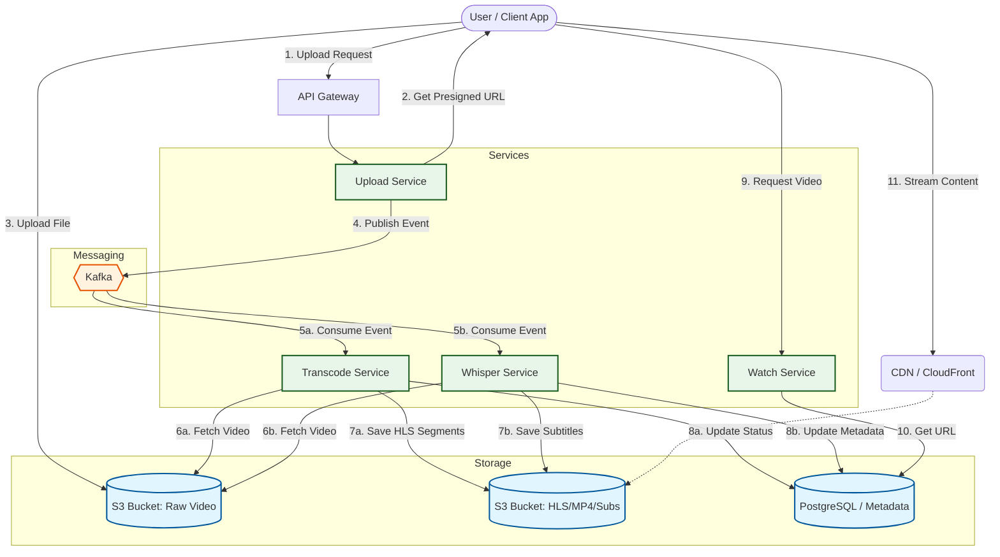

A scalable microservices-based video streaming platform designed for efficient video upload, transcoding, and adaptive playback.

## Table of Contents
- [System Design](#system-design)
- [Getting Started](#getting-started)

## System Design



## Key Feature

- **Secure HLS Endpoints:** The streaming endpoints (master playlist and video segments) are now protected and require a valid token to access.
- **Video-Specific Access:** The middleware verifies not just the validity of the token but also ensures the token is issued specifically for the video being requested, preventing token reuse across different assets.
- Built a **Transcode Service** with FFmpeg to convert videos into HLS-compatible formats for **adaptive streaming.**
- Audio Transcription using **Whisper AI**

## Getting Started

### Prerequisites

- Docker
- Docker Compose
- Node.js (for local development)
- MINIO (Docker container)

### Installation

1. Clone the repository:

    ```sh
    git clone https://github.com/your-repo/project-name.git
    cd project-name
    ```

2. Create environment variable files for each service:

    [.env](http://_vscodecontentref_/1)

### Environment Variables

1. Frontend
\
Create a `.env` file in the [frontend](http://_vscodecontentref_/5) directory with the following content:

```env
DATABASE_URL=your_database_url
DRIZZLE_DATABASE_URL=your_drizzle_database_url
AUTH_SECRET=your_auth_secret
Github_Client=your_github_client_id
Github_Secret=your_github_client_secret
Google_Client=your_google_client_id
Google_Secret=your_google_client_secret
AUTH_TRUST_HOST=your_auth_trust_host
RESEND_API_KEY=your_resend_api_key
```
2. Transcode
\
Create a `.env` file in the [transcode-service](http://_vscodecontentref_/5) directory with the following content:

```env
AWS_ACCESS_KEY_ID=your_aws_access_key_id
AWS_SECRET_ACCESS_KEY=your_aws_secret_access_key
AWS_BUCKET=yt-krishna
DATABASE_URL=your_database_url
```
3. Upload 
\
Create a `.env` file in the [Upload-service](http://_vscodecontentref_/5) directory with the following content:

```env
DATABASE_URL=your_database_url
EndPoint=MINIO Endpoint
ACCESS_KEY_ID=your_MINIO_secret_key
SECRET_ACCESS_KEY=your_MINIO_secret_access_key
AUTH_SECRET=
```
3. Watch
\
Create a `.env` file in the [Watch-service](http://_vscodecontentref_/5) directory with the following content:

```env
DATABASE_URL=your_database_url
EndPoint=MINIO Endpoint
ACCESS_KEY_ID=your_MINIO_secret_key
SECRET_ACCESS_KEY=your_MINIO_secret_access_key
AUTH_SECRET=
```
3. Audio Transcription
\
Create a `.env` file in the [audio_transcription-service](http://_vscodecontentref_/5) directory with the following content:

```env
DATABASE_URL=your_database_url
EndPoint=MINIO Endpoint
ACCESS_KEY_ID=your_MINIO_secret_key
SECRET_ACCESS_KEY=your_MINIO_secret_access_key
AUTH_SECRET=
```


### Running the Project

1. Docker Compose

```docker-compose up --build```


### Local Environment

1. Frontend
    - Naviate to frontend
        
        ```cd frontend```

    - Install dependencies

        ```npm install```

    - Run the development server    

        ```npm run dev```

    - Open http://localhost:3000 with your browser to see the result.


2. Transcode Service
    - Naviate to Transcode
        
        ```cd transcode-service```

    - Install dependencies

        ```npm install```

    - Run the development server    

        ```npm run dev```


4. Watch Service
    - Naviate to Watch
        
        ```cd watch-service```

    - Install dependencies

        ```npm install```

    - Run the development server    

        ```npm run dev```
5. Audio Transcription Service
    - Naviate to Audio Transcription Service
        
        ```cd audio_transcription-service```

    - Install dependencies

        ```npm install```

    - Run the development server    

        ```npm run dev```

### License


```
Feel free to customize the content as needed for your specific project

